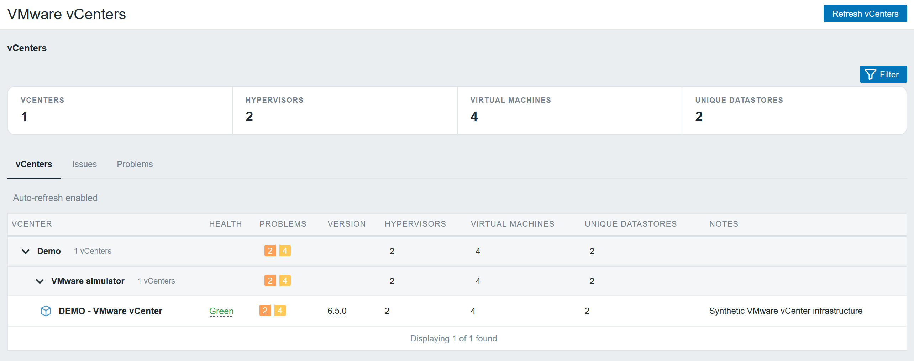
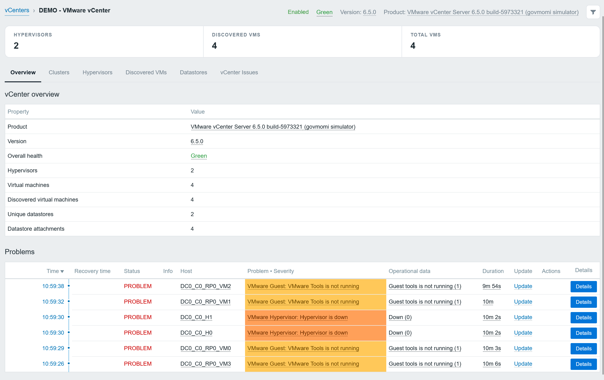
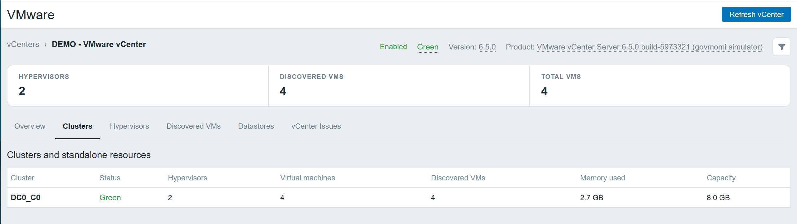
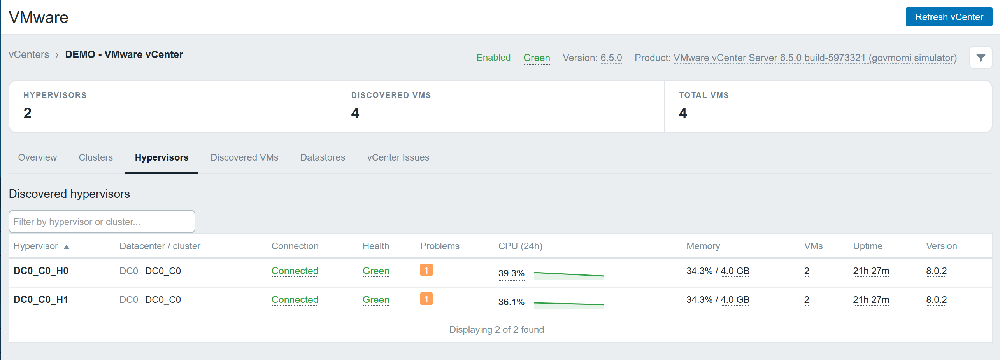
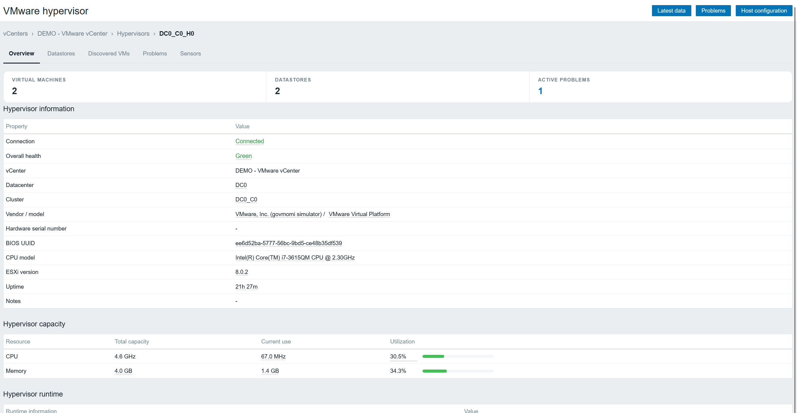

# VMware Monitoring for Zabbix 7.0

Explore VMware infrastructure using the hosts, items, history, inventory and problems already
collected by Zabbix. The module reads the Zabbix API with the signed-in user's permissions;
Zabbix server or proxy collectors connect to vCenter.

## Features

| View | Information and actions |
|---|---|
| vCenters | Health, version, inventory notes, problems and resource counts, with optional nested location groups. |
| vCenter overview | Product information, discovered resources and the native Zabbix Problems table. |
| Hypervisors | Placement, connection, health, problems, 24-hour CPU sparklines, memory, VM count, uptime and ESXi version. |
| Discovered VMs | Notes, placement, power and runtime states, problems, CPU history, memory, storage, VMware Tools, snapshots and uptime. |
| Clusters | Health and resource counts, with detail pages for capacity, utilization, configuration, sensors, problems and member hypervisors. |
| Datastores | Unique datastores with expandable per-hypervisor capacity, free space, latency, IOPS and multipath measurements. |
| Distributed switches (opt-in) | Switch identities, port attachment and link counts, blocked ports, conflicts, collection errors and native item actions. |
| Issues and Problems | VMware alarm items and native Zabbix problem information scoped to the selected environment. |
| Hypervisor details | Hardware and software information, capacity, runtime metrics, datastores, discovered VMs, problems and sensors. |

Item-backed values open the native Zabbix menu: **Item**, **Graph** for numeric items,
**Values**, and **500 latest values**. Zabbix determines configuration permissions and
history availability. Native item and host dialogs allow authorized configuration changes.
Calculated totals and physical sensor readings derived from the compact sensor payload have
no individual source-item menu.

Detail tabs load on demand. Search and sorting are available in supported inventories;
pagination follows the user's **Rows per page** setting. The module supports Zabbix blue,
dark and high-contrast dark themes and works independently of other monitoring modules.

## Screenshots

The screenshots below use the synthetic VMware demo environment.

### vCenter inventory

Grouped vCenters with health, problem summaries, resource counts, and inventory notes.



### vCenter overview

Product information, discovered resources, and the native Zabbix Problems table.



### Clusters

Cluster health, hypervisor and VM counts, and memory usage and capacity.



### Hypervisors

Host placement, connection and health states, CPU history, memory utilization, and uptime.



### Hypervisor details

Hardware and software information, capacity and utilization, and access to related resources.



## Requirements

| Component | Requirement |
|---|---|
| Zabbix | Server or proxy and frontend on version 7.0. |
| Collection | VMware collectors enabled on the server or proxy responsible for the vCenter. |
| Templates | Configured `VMware`, `VMware Hypervisor` and `VMware Guest` monitoring templates. |
| Discovery | Hypervisor and VM hosts created by the vCenter template's host prototypes. |
| Access | Permission to use Monitoring and Latest data, plus access to the relevant hosts. Configuration actions require additional Zabbix permissions. |

The module identifies vCenters through the monitored item
`vmware.version[{$VMWARE.URL}]`, rather than a host or template name. Hypervisors and VMs
are associated through their originating low-level discovery rules. Manually created hosts
linked only to a hypervisor or guest template lack that relationship and may not appear.

The frontend module needs no Composer, npm, compilation or extra VMware credentials.
Its optional demo tools have separate Python and Docker requirements.

## Installation and upgrade

1. Copy this module into a directory under the Zabbix frontend's `modules` folder, for example
   `/usr/share/zabbix/modules/vmware_monitoring`.
2. Ensure the frontend can read the module files.
3. Open **Administration → General → Modules**, select **Scan directory**, and enable
   **VMware Monitoring**.
4. Open **Monitoring → VMware**.

For an upgrade, replace the module files, scan the directory again and reload the browser.
Exclude the repository's `.git` directory from production packages.

## Using the module

1. Configure VMware collection in Zabbix and wait for discovery and the first samples.
2. Open **Monitoring → VMware**. The main page offers **vCenters**, **Issues** and **Problems**.
3. Select a vCenter to browse **Overview**, **Clusters**, **Hypervisors**, **Discovered VMs**,
   **Datastores** and **vCenter Issues**.
4. Click a hypervisor name to open its detail page; right-click it for the native Zabbix host
   menu. VM names open the native host menu. Hypervisor host menus also include **Sensors**.
5. Click a cluster name for cluster details, or expand a datastore to load attachment metrics.
6. Click an item-backed value for its configuration, graph and history actions.

**Refresh vCenters** updates the main inventory; **Refresh vCenter** clears the selected
view's cached data and reloads the stored Zabbix results. These controls do not execute
VMware checks or force discovery on the server or proxy.

Monitoring payloads are cached in private temporary files on the frontend, scoped to the
user and login session. Only a small invalidation token enters the session cookie. When
private storage is unavailable, data is read without that server cache.

### Location groups and inventory notes

Define the host macro `{$VMWARE.LOCATION}` directly on a vCenter:

```text
USA
USA, New York
USA, New York, Rack 2
```

Comma-separated values create nested groups. vCenters without the macro remain ungrouped.
Click a group's arrow or name to collapse it; the state is saved per Zabbix user.

Group totals include all filtered descendant vCenters, including those on other pages.
Shared datastore identities and problem events are deduplicated. Child groups retain their
own collapse state when a parent is reopened.

Populate host inventory **Notes** (`{INVENTORY.NOTES}`) to display descriptive information
in the vCenter and VM inventories and hypervisor details.

### Hardware sensors

Enable `{$VMWARE.HV.SENSOR.DISCOVERY}=true` on the relevant hypervisor and allow discovery
and collection to complete. The Sensors tab provides name, status and type filters, current
readings, health states, collection errors and related problems.

Physical readings and health-detail tooltips require the additional dependent text item
`vmware.hv.sensors.data` from the adapted monitoring template. Without that item, sensor
health and problems remain available while **Current reading** displays `-`. Installing
the UI module does not add or modify monitoring items or templates.

### Distributed switches (optional template)

Import [VMware Distributed Switches](templates/vmware-dvswitches.yaml) in **Data collection →
Templates → Import**, then link it to the **same vCenter host** alongside the existing
`VMware` template. It uses that host's `{$VMWARE.URL}`, `{$VMWARE.USERNAME}` and
`{$VMWARE.PASSWORD}` macros. No additional host or VMware credentials are needed.
The module does not automatically import or link templates. Its **Distributed switches**
tab explains how to opt in when the companion is absent.

The companion uses native `vmware.dvswitch.discovery` and
`vmware.dvswitch.fetchports.get` simple checks. Discovery runs hourly; an unfiltered
port-state snapshot runs every five minutes for each switch, including uplinks.
Dependent items record total ports, attached ports, links up, attached ports with links
down, blocked ports and conflicts. Missing runtime state is not counted as a down link.
Blocked ports can reflect intentional policy; they have no default alert.

The template normalizes both documented `{#DVS.*}` and Zabbix 7.0.22's actual
`{#DVSWITCH.*}` discovery macros to support both payload forms.

| Macro | Default | Purpose |
|---|---|---|
| `{$VMWARE.DVS.DISCOVERY.INTERVAL}` | `1h` | Switch discovery interval. |
| `{$VMWARE.DVS.INTERVAL}` | `5m` | Port snapshot interval. |
| `{$VMWARE.DVS.INVENTORY.INTERVAL}` | `5m` | Refresh the shared VM and hypervisor ID-to-name inventories for this vCenter. |
| `{$VMWARE.DVS.NAME.MATCHES}` | `.*` | Include switch names matching this regular expression. |
| `{$VMWARE.DVS.NAME.NOT_MATCHES}` | `CHANGE_IF_NEEDED` | Exclude switch names matching this expression. |
| `{$VMWARE.DVS.CONFLICTS.MAX}` | `0` | Alert when every available sample in five minutes exceeds this count. |
| `{$VMWARE.DVS.CONNECTED.DOWN.MAX}` | `0` | Same threshold for attached ports with an explicitly down link. |
| `{$VMWARE.DVS.NODATA}` | `15m` | Alert when no successful port snapshot arrives; keep longer than the polling interval. |

Override these macros on individual vCenter hosts as needed. Removed or filtered switches
are disabled immediately and deleted after seven days. The raw port JSON is retained for
one day; count history for seven days and trends for 90 days. Fetching every port can be
costly on large switches: narrow the discovery filters or increase the interval and
no-data window. The template creates two shared name-inventory items per vCenter,
plus eight items and three triggers per switch, without
creating an item for every port. It reports state snapshots, not bandwidth or packet rates.

The tab provides search, pagination, sample timestamps and collection errors. Click a
switch name to open its detail page, a count for native graph/history actions, or the
collection timestamp for the source port item's actions.
Collection errors and absent samples should be checked before interpreting zero counts
as healthy. These switch-level triggers also appear in the existing native Problems view.

The switch detail page uses the **existing state payload** for port information. VM names
are resolved separately from one compact inventory snapshot shared by all switches:

| Detail tab | Information |
|---|---|
| Ports | Port and group IDs, attached VM names, resolved hypervisor names, NIC identity/type, link/blocked/conflict states, VLAN ranges, trunking, MAC address and peer. Search VM/hypervisor names or reported values and filter by state, port group or resource. VM and host IDs remain available on hover and serve as labels when names cannot be resolved. |
| Port details (expand a port) | A full-width row below the port, with runtime details beside paired counter columns and an expandable complete field/value view. The button supports keyboard activation and reports its expanded state. |
| Port groups | Groups derived from port-group IDs, observed port/state counts, VLAN ranges and unique attached-resource counts. Group links filter the Ports tab. |
| Connected resources | VM/hypervisor names and unique VM/host IDs with attached-entity versus proxy-host roles, observed port counts, group IDs and NICs. Resource links filter the Ports tab. |
| Statistics | Every numeric port counter reported in the payload, summed across reporting ports, with explicit coverage counts. Includes unicast/multicast/broadcast bytes and packets, drops and exceptions when supplied. |
| Problems | Active Zabbix events from triggers tagged with this switch's UUID; acknowledged and suppressed events remain identifiable. |

Each tab is paginated using the user's Rows per page setting. Missing runtime fields
display **Unknown** and missing counters remain unavailable. Counter sums preserve exact
unsigned values and represent cumulative snapshots, not bandwidth rates; partial coverage
is shown, and traffic traversing several ports may be counted several times. Resource and
port-group names, switch MTU and other switch configuration are absent from this payload.
Collection errors and old samples remain visible alongside the last stored snapshot.

For VM and hypervisor name resolution, reimport the updated companion template with **Update existing**
templates and **Create new** items enabled. The new regular text item
`vmware.vm.discovery["{$VMWARE.URL}"]` stores only VM IDs and names from the native
VMware collector; `vmware.hv.discovery["{$VMWARE.URL}"]` does the same for hypervisors.
Quoted URLs keep these item keys distinct from the standard template's unquoted
discovery-rule keys. These items create no additional discovery rules or hosts.
VMware credentials stay with the server/proxy collector; the module performs one
permission-scoped Zabbix API lookup for both inventories and all referenced IDs, not one request per port.
IDs are matched by resource type within the selected vCenter. Repeated IDs are deduplicated;
unknown, inaccessible or outdated inventories fall back to IDs. Inventory timestamps and
resolution counts are shown on the detail page when the corresponding resources are present.
An absent `connectee` in the port payload cannot be reconstructed from VM names alone.

To opt out, **unlink and clear** only `VMware Distributed Switches` on that vCenter host.
This removes its discovered items, triggers and history. Ordinary unlinking retains those
items on the host and therefore retains collection. The standard VMware template is independent.

References: [Zabbix 7.0 VMware keys](https://www.zabbix.com/documentation/7.0/en/manual/vm_monitoring/vmware_keys)
and [port JSON structure](https://www.zabbix.com/documentation/7.0/en/manual/vm_monitoring/vmware_json#vmware.dvswitch.fetchports.get).

### Understanding counts and missing values

**Virtual machines** / **Total VMs** are hypervisor-reported totals. **Discovered VMs** counts
VM hosts created by Zabbix discovery. Filters, permissions and sample availability can make
these counts differ.

Missing values can indicate absent items, unavailable samples or collection errors. Inspect
native **Latest data** and the item's error before interpreting an empty value as healthy.
CPU sparklines require retained history and build up after monitoring starts.

## Demo without VMware hardware

The optional [VMware mock setup guide](dev/mock-vmware/README.md) provides a removable
SOAP/REST simulation using `vcsim` and an isolated Zabbix proxy. The dataset contains one
vCenter, one cluster, two hypervisors, four VMs, two datastores and a distributed switch.
The demo gateway provides eight populated switch ports, including VM attachments,
modeled uplinks, VLANs and synthetic runtime/traffic counters. The opt-in template is
required to collect and display switch data.

Run these commands from the module directory:

```powershell
python dev/mock-vmware/demo.py up
python dev/mock-vmware/demo.py status
python dev/mock-vmware/demo.py scenario --scenario degraded
python dev/mock-vmware/demo.py scenario --scenario unresponsive
python dev/mock-vmware/demo.py scenario --scenario healthy
python dev/mock-vmware/demo.py down
```

Setup requires Python 3.10+, Docker Compose, the three installed VMware templates and
Zabbix API permissions to manage the isolated fixture. Enter the Zabbix password when
prompted, or use `ZABBIX_PASSWORD` / `ZABBIX_API_TOKEN`. Allow **2–5 minutes** for discovery
and initial samples; setup prints a link that refreshes the module's vCenter inventory.

The helper clones the installed templates and creates demo objects; it preserves the
original templates and existing server configuration. `down` removes the owned fixture
and its disposable monitoring history, with safeguards against removing unrelated objects.

The **degraded** scenario makes vCenter appliance health red and models a blocked,
conflicting VM port with its link down and growing error counters. **Healthy** restores
the link and clears those flags. **Unresponsive** exercises real SDK/REST timeouts while keeping scenario
controls available. The simulator does not implement every vSphere counter or hardware
failure; some device-specific metrics can remain unsupported. See the setup guide for
network settings, endpoints, credentials, coverage limits and cleanup details.

## Acknowledgements

Module scaffolding and the original UI/UX approach were based on
[Monzphere/zabbix-module-docker](https://github.com/Monzphere/zabbix-module-docker).
